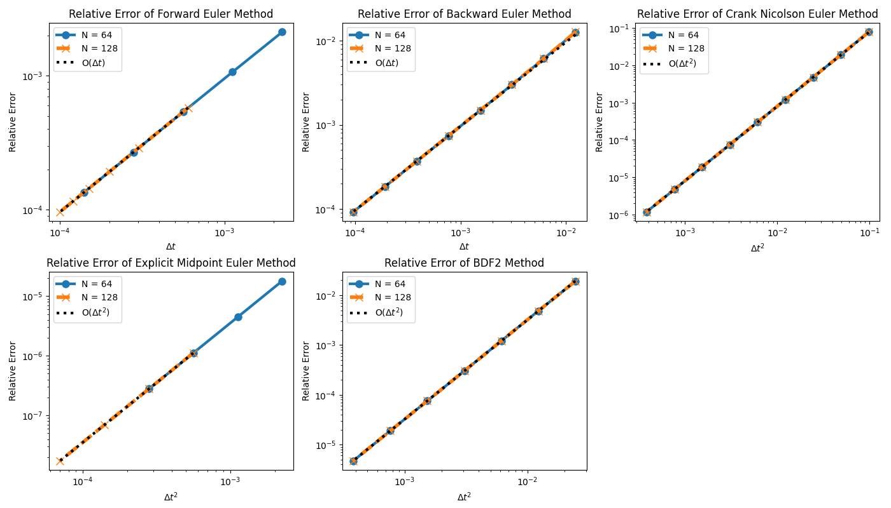

# HW 3: Time Stepping

## Setup
For the set up, a major part of it related to the use of the code and not related to the actual coding of the 5 time stepping methods. For the derivation, plug $$u = \cos (10t) \sin (x) \sin (y)$$ into the PDE to get $$f = (2 \cos 10t - 10 \sin 10t) \sin (x) \sin (y)$$, with $$u = 0$$ on all four edges and $$u(x, y, 0) = \sin (x) \sin (y)$$. Discretizing spatially gives 
$$\frac{du}{dt} = Lu(t) + f(t)$$
so we need to find the discrete forcing function. Say for some $$x, y$$ that are constant then say $$S = \sin (x)\sin (y)$$ is a vector and do the 1D stencil for both x and y and we get that 
$$f(t) = \frac{du}{dt} - L u = -10 \sin(10t) S - \cos (10t) L S$$
Using the 1D stencil for $$\sin (x)$$ and $$\sin (y)$$ and we get that 
$$LS = \frac{8}{\Delta x^2} \sin \left ( \frac{\Delta t}{2} \right )^2 \sin (x)\sin (y)$$
So our forcing function becomes
$$f(t) = \left (\frac{8}{\Delta x^2} \sin \left ( \frac{\Delta t}{2} \right )^2 - 10 \sin (t) \right )S$$

### The following were used for the formulas of the methods

#### Forward Euler
$$u(t_{n+1}) = u(t_n)  + \Delta x (L u(t_n) + f(t_{n}))$$

### Backward Euler
$$(I - \Delta L)u(t_{n+1}) = u(t_n) + \Delta t f(t_{n+1})$$

### Crank Nicolson
$$(I - \frac{1}{2} \Delta L)u(t_{n+1}) = u(t_n) + \Delta t (f(t_{n+1}) + Lu(t_n) + f(t_{n+1}))$$

### Explicit Midpoint (RK2)
$$u(t_{n+\frac{1}{2}}) = u(t_n)  + \frac{\Delta x}{2} (L u(t_n) + f(t_{n}))$$
$$u(t_{n+1}) = u(t_n)  + \Delta x (L u(t_{n+\frac{1}{2}}) + f(t_{n+\frac{1}{2}}))$$

### BDF2
$$(2 \Delta L - 3I)u(t_{n+1}) = -4 u(t_n) + u(t_{n-1}) - 2 \Delta t f(t_{n+1})$$

## Problem 1 Relative Error

|  |
| :-: |
| *Figure 1: Relative Error for all 5 time stepping methods.$ |

## Problem 2 

| Method | Number of Steps | Cost |
|------|-------------|------|
| Forward Euler | 2608 | 50,125,760 |
| Backward Euler | 151 | 5,144,505 |
| Crank Nicolson | 81 | 4,418,515 |
| Explicit Midpoint | 2608 | 100,251,520 |
| BDF2 | 156 | 5,314,852 |

| Method | Number of Steps | Cost |
|------|-------------|------|
| Forward Euler | 5997 | 115,262,340 |
| Backward Euler | 6078 | 207,074,847 |
| Crank Nicolson | 563 | 30,711,408 |
| Explicit Midpoint | 2608 | 100,251,520 |
| BDF2 | 1129 | 3,8464,544 |

| Method | Number of Steps | Cost |
|------|-------------|------|
| Backward Euler | 1207446 | 41,137,166,282 |
| Crank Nicolson | 7955 | 433,941,831 |
| Explicit Midpoint | 5288 | 203,270,720 |
| BDF2 | 15914 | 542,183,140 |

| Method | Number of Steps | Cost |
|------|-------------|------|
| Forward Euler | 10431 | 854,507,520 |
| Backward Euler | 151 | 24,007,690 |
| Crank Nicolson | 81 | 19,513,817 |
| Explicit Midpoint | 10431 | 1,709,015,040 |
| BDF2 | 156 | 24,802,647 |

| Method | Number of Steps | Cost |
|------|-------------|------|
| Forward Euler | 10431 | 50,125,760 |
| Backward Euler | 6078 | 966,349,289 |
| Crank Nicolson | 563 | 135,633,077 |
| Explicit Midpoint | 10431 | 1,709,015,040 |
| BDF2 | 1129 | 179,501,208 |

| Method | Number of Steps | Cost |
|------|-------------|------|
| Backward Euler |  |  |
| Crank Nicolson | 7955 | 1,916,449,611 |
| Explicit Midpoint | 10431 | 1,709,015,040 |
| BDF2 | 15913 | 2,530,028,997 |